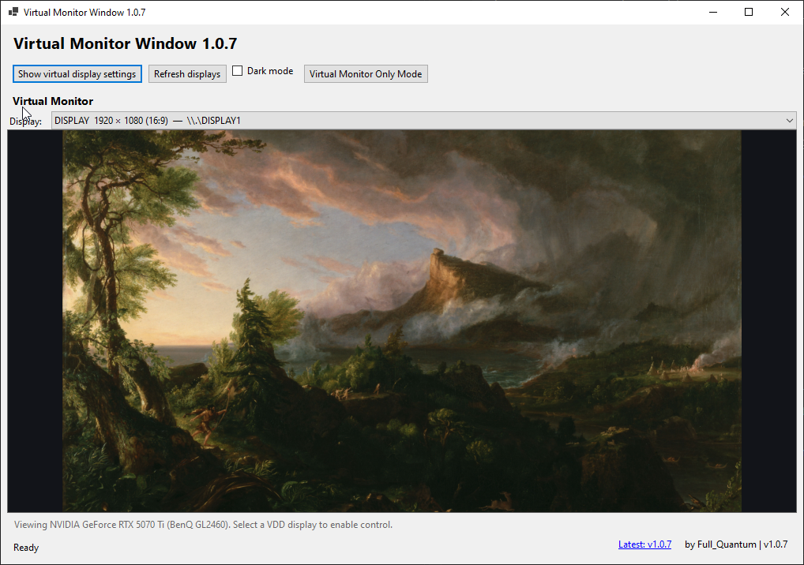
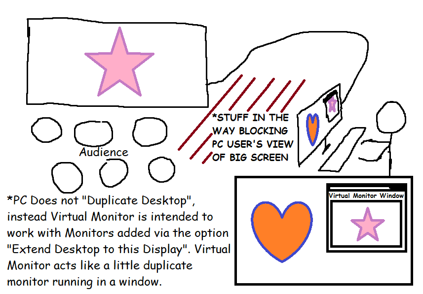

# Virtual Monitor Window

Virtual Monitor Window is a portable Windows app for viewing a display in a
resizable window.

## Why this exists

If people or objects block the view of a large screen, its content can be hard to see.
Virtual Monitor Window shows the extended display in a small resizable window, like a
little duplicate monitor.

## Features

- Virtual Monitor mirrors any display connected in a resizable window
- See your monitor around corners and behind objects, perfect for presentation scenarios
- "Virtual Monitor Only Mode" button
- Light and dark themes.
- Self-contained x64 Windows executable; no separate .NET installation is
  required to run the published app.

## Driver note

The optional virtual display driver is installed system-wide and is not removed by deleting this app. Remove it with Device Manager.

## Third-party components

This project bundles the Virtual Display Driver and Nefcon helper packages.
Their project links, release versions, and license texts are in
[THIRD-PARTY-NOTICES.txt](./THIRD-PARTY-NOTICES.txt).

I'm probably getting some of this wrong. I'm trying to credit everyone in the
most acceptable way, so feedback is appreciated. If you spot a missing or
incorrect attribution or license notice, please open an issue.

The Virtual Monitor Window source code, documentation, and included
illustration are available under the MIT License in [LICENSE](./LICENSE).
The self-contained Windows executable also bundles the open-source .NET
runtime. The bundled runtime, Virtual Display Driver, and Nefcon helper have
their own license and attribution notices in
[THIRD-PARTY-NOTICES.txt](./THIRD-PARTY-NOTICES.txt) and
[DOTNET-THIRD-PARTY-NOTICES.txt](./DOTNET-THIRD-PARTY-NOTICES.txt).

## Credit

Created by **Full_Quantum**.
